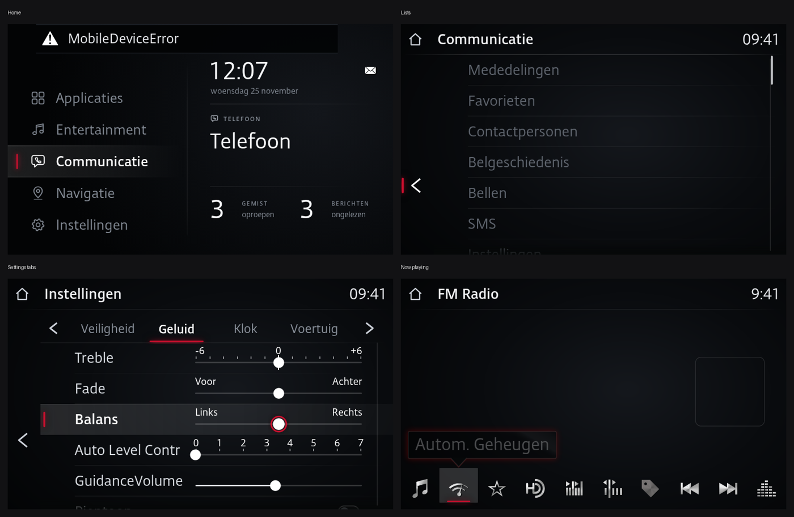

# mzd-cmu-ui (B2 overlay) - Mazda Connect CMU alternative UI layer - firmware v74

> **DRAFT - for testing only. Under active development. Not ready for daily use.**
>
> Things change and break between commits. Only install this if you can recover your CMU (serial console / SSH) and accept the risk.
>
> **Built and tested for firmware v74.00.324 only.** It may also work on older firmware (e.g. v54/v59), but that is untested and the build refuses a GUI dump that does not match the v74 md5 list.

An alternative dark "B2" theme/UI layer for the Mazda Connect CMU (head unit) on firmware **v74.00.324**.
It is injected at runtime into the stock Opera-based GUI (Presto 2.12 / Opera 12.10): a bind-mounted overlay
replaces **four** ecoenergy (fuel consumption) app templates with hook-enabled copies and adds its own
JS/CSS/PNG assets. Everything is toggled from an in-car panel under **Applications > Fuel consumption**
("Fuel consumption" in a Dutch-locale car).

**Stock files are never overwritten.** The overlay lives in a copy of `/jci/gui` under
`/data_persist/oemplus-test/gui`, bind-mounted over `/jci/gui` at runtime (RAM-only). Revert = unmount + reboot
(Mute+Navi held for 10 s). After a reboot the CMU is back to factory.

## What it looks like

Rendered in the headless test harness (real v74 GUI code + overlay in headless Chromium). On-screen
labels are Dutch because it was developed on a Dutch-locale car.

## Status

| Part | What | Status |
|---|---|---|
| B2 home | Alternative home screen (clock, app rows, context panels), replacing MainMenuCtrl at runtime | Implemented, harness-proven; live-on-car tested once |
| P0 base | `body.OemplusB2` class + loader for the submenu CSS files + protected-screen guard + base CSS/assets | Done (harness 86/86) |
| P1 list | List2 screens (Applications, Communication, lists with checkboxes/radios/toggles/sliders/scrollbar) | Done (harness 54/54) |
| P2 dialogs | Dialog3 popups (buttons, progress meters, PIN entry, splash dialogs) | Done (harness 82/82) |
| P3 tabs/sliders | TabsCtrl tabs + prev/next arrows, standalone sliders, generic 150x100 buttons | Done (harness 72/72) |
| P4 media/input | NowPlaying4/Ump3 (radio/USB audio), DialPad, on-screen Keyboard | Done in harness (52/52); Bluetooth-audio screen not yet covered by the harness |

All harness suites together: 374 checks + 53 shell-script checks under busybox 1.19.0, 0 failures
(see `docs/TESTING-ON-THE-CAR.md` for how to run them). Placeholder work that is still open: icon restyling
(P5), messaging/scroll-detail/tuner screens, animated spinner (Presto cannot animate a div background, so the
progress spinner is static).

## Repo layout

- `src/OemplusInject.js`, `src/OemplusInject.css` - injection core + the in-car toggle panel (loaded once
  into the running GUI).
- `overlay-src/` - the files that are added to the GUI tree on top of the stock dump:
  - `apps/system/controls/MainMenu/js|css/MainMenuCtrl-oemplusb2.{js,css}` - the B2 home control + CSS
  - `common/controls/StatusBar/css/StatusBarCtrl-oemplusb2.css`, `common/controls/Sbn/css/SbnCtrl-oemplusb2.css` -
    status bar / notification banner styling
  - `common/oemplusb2/css/B2Sub-00..40-*.css` - submenu skin files, loaded in fixed order
  - `common/oemplusb2/images/*.png` - generated PNG assets (137 files)
- `tools/` - host and on-CMU scripts:
  - `make_overlay.py` (host) - builds `overlay/` from your own stock dump in `stock/` + `src/` + `overlay-src/`;
    patches the 4 ecoenergy templates byte-exactly and verifies md5 against the CMU-made checksum list
  - `apply_inject.sh`, `revert_inject.sh`, `kopie_gelijk.sh`, `kopie_vers.sh`, `aa_wacht.sh` (CMU) - copy the
    overlay into / out of the test copy of `/jci/gui`, with full-tree md5 comparison before/after
  - `mount_inject.sh camera-ok`, `terug_inject.sh` (CMU) - the single bind mount (with prechecks incl. a
    mandatory reversing-camera check) and the revert (umount + reboot)
  - `assets/*.py` - generators for all PNG assets; `check_presto.py` - static ES5/Presto compatibility check
- `harness/` - headless test harness (see `docs/TESTING-ON-THE-CAR.md`)
- `docs/overview.png` - UI overview image (above)
- `stock/` - **your own CMU dumps go here** (see `stock/README.md`); everything under `stock/` except the
  README is gitignored
- `docs/DESIGN.md` - architecture; `docs/TESTING-ON-THE-CAR.md` - build, harness and on-car test procedure

## Requirements

- Mazda Connect CMU with firmware **v74.00.324** (the overlay's md5 checks are tied to that firmware's files).
- SSH access on the CMU (port 2222), e.g. via the mzd-toolkit: <https://github.com/espen795/mzd-toolkit>
- Enough free space on `/data_persist` for a full copy of `/jci/gui` (~1100 files).
- On the host: Python 3 (overlay build), Playwright + Chromium (harness only).

## No Mazda files in this repo

The stock GUI is **not** included here and is not distributed. You must dump `/jci/gui` from **your own** CMU
into `stock/` - see `stock/README.md` for exactly what to copy and how the checksums are made.
`tools/make_overlay.py` patches the 4 ecoenergy templates from that dump at build time and verifies every
file against the md5 list made on the CMU (`stock/v74/MD5SUMS.cmu`); if your dump does not match, the build
refuses to produce an overlay.

Note: code comments and some on-screen labels are still Dutch (the UI was developed on a Dutch-locale car).

## Safety

- **Protected screens are never restyled**: the reversing camera (backupparking), warning guide, emergency
  (mobile911), Android Auto, CarPlay, navigation guidance (emnavi), diagnostics, tutorial and the system
  power/display-off/intro screens are excluded by a guard that removes the B2 body class before the first
  paint of those screens. A class on the wrong screen is removed within 500 ms as a fallback.
- **Safety notifications are never filtered**: the SBN banner stays visible and in B2 style; only the
  navigation street-name banners are suppressed while B2 is on. Error/device/Bluetooth/volume notifications
  are never touched.
- **Mandatory reversing-camera check before mounting**: `mount_inject.sh` refuses to run without the
  `camera-ok` argument - put the car in R and confirm the camera image works *in this boot* before mounting.
- **Revert is always available**: `terug_inject.sh` unmounts and reboots; a reboot (Mute+Navi 10 s) alone
  also fully removes the overlay because nothing is persisted. The scripts never write to `/jci`, never touch
  `sm.conf`/autorun, and never kill or restart the GUI process.
- Worst case known failure mode: if a patched template itself fails to load/parse (not a runtime error in the
  hook), the framework's state timeout triggers an automatic board reset; after the reset the mount is gone
  and the CMU is factory again. This is why the mount script requires a healthy boot (uptime/crash-counter
  guard) first.

## Related

- <https://github.com/espen795/mzd-toolkit> - SSH access on v74 (needed to copy files to/from the CMU).

## License

License: to be decided.

## AI-assisted development

This project was developed with AI assistance (code, design notes and test harness were written and reviewed
with AI agents). All safety-critical scripts (mount/revert) are deterministic shell with hard prechecks and
full-tree checksum verification; still, treat this as experimental software: use at your own risk.
